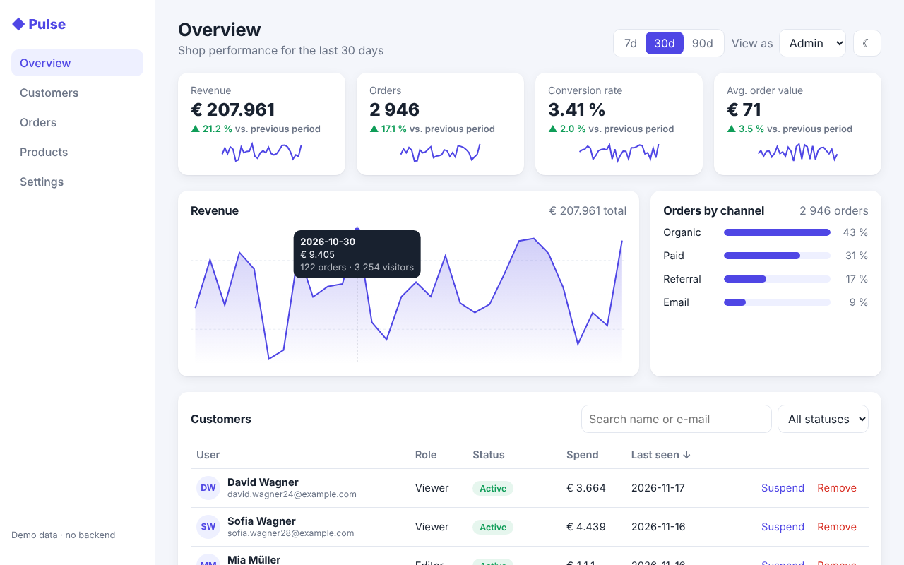
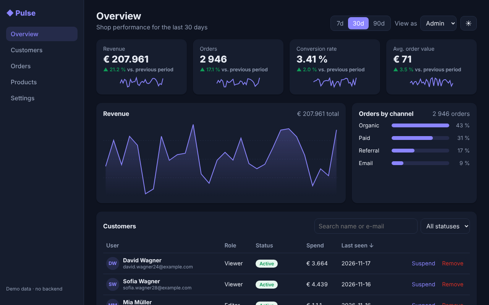
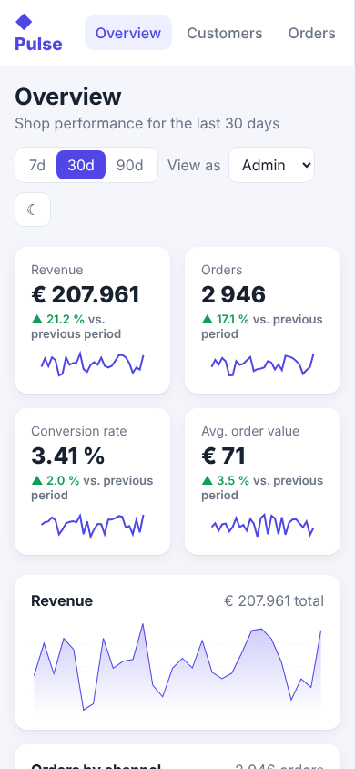

# Pulse – React admin dashboard

An analytics and customer-management dashboard for an online shop: KPI cards with trends, an interactive revenue chart, channel breakdown and a customer table with search, filters, sorting, pagination and role-based actions. Light and dark theme.

**[▶ Live demo](https://anton-simeon.github.io/pulse-dashboard/)**

| Overview | Dark mode | Mobile |
|---|---|---|
|  |  |  |

## Features

- **KPIs:** revenue, orders, conversion rate and average order value with change vs. the previous period and sparklines
- **Date range** switch (7 / 30 / 90 days) – everything recalculates
- **Revenue chart:** hand-built SVG (no chart library) with hover cursor and tooltip
- **Customers table:** search, status filter, sortable columns with `aria-sort`, pagination
- **Roles:** "view as" Admin / Editor / Viewer – editing actions are only available to admins
- **Optimistic actions with undo:** suspend / reactivate / remove a customer, undo from the toast
- **Dark mode** following the system preference, responsive layout down to phones

## Tech

React 18 · TypeScript (strict) · Vite · Vitest · plain CSS with custom properties · GitHub Actions → GitHub Pages

All calculations (KPIs, period comparison, table query, SVG path building) are pure functions in [`src/analytics.ts`](src/analytics.ts), covered by [`src/analytics.test.ts`](src/analytics.test.ts). Demo data is generated by a seeded PRNG, so the dashboard and the tests are deterministic.

## Run locally

```bash
npm install
npm run dev
npm test
npm run build
```

---

Built by [Volodymyr Anton-Simeon](https://github.com/Anton-Simeon) – Senior Frontend Engineer (React · Next.js · TypeScript).
